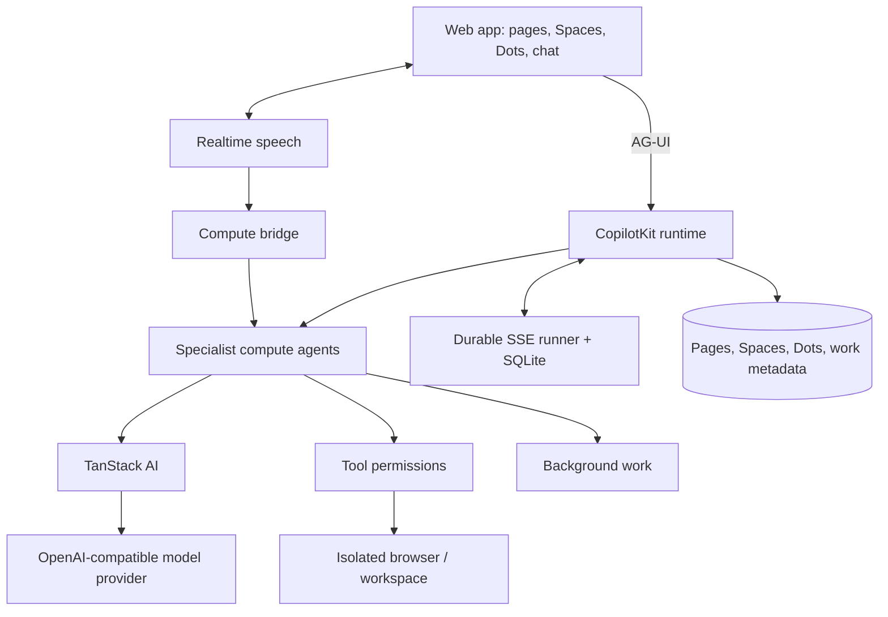

<div align="center">

# NevaDots

### Always-on AI coworkers that move between text and calls.

**An open-source, self-hosted fork for persistent AI agents, each with its own computer.**

</div>

<div align="center">

Built with [CopilotKit](https://github.com/CopilotKit/CopilotKit) and [AG-UI](https://docs.ag-ui.com/introduction). · [Get started](#get-started) · [Overview](#overview) · [Architecture](#architecture) · [Features](#features) · [Contributing](CONTRIBUTING.md)

[](https://github.com/Hajrudin-Zelef/NevaDots/actions/workflows/ci.yml)
[](./LICENSE)


Host NevaDots on your own infrastructure. Conversations are persisted locally in SQLite by a durable SSE agent runner — no hosted Intelligence, no third-party service. Clone this fork and customize it however you want.

</div>

---

<div align="center">

<table><tr><td>

https://github.com/user-attachments/assets/4c74fe7d-ecdd-42dd-95da-5d34f9b9576e

</td></tr></table>

</div>

_Ask → browse → approve → save. A live computer view and a human review card appear right in chat, then the approved draft becomes an editable Space page. Enlarged for readability; idle time is trimmed and playback is accelerated._

## Overview

NevaDots is a self-hosted fork of [OpenDots](https://github.com/CopilotKit/OpenDots) for your own agent workspace. Clone it, define your Dots, connect your services, and adapt the interface and tools to your needs.

**A fork, not a hosted product.** You run the application and configure its infrastructure. The Features section below describes what's included.

### Spaces

A Space is a home for working documents. Dots appear separately in navigation and can be granted access to multiple Spaces in their settings. Each Dot has a default destination for saved pages; existing installations retain their original Space access. Browse pages in a searchable library, switch between grid and list views, and organize documents as nested subpages. Open a page in a focused visual editor with formatting, slash commands, and undo/redo. Write directly, save a conversation as a page, or ask a specialist to create and revise content.

Pages stay in the local workspace database. Their conversations are persisted locally in SQLite, with a separate conversation for each page and specialist. Page links connect the document workspace to Dot chat. Manual editing works before you configure conversation services. Autosave reports its progress, failed saves retain your draft, and revision checks prevent stale edits from overwriting newer content. Markdown source mode remains available.

<div align="center">

<table><tr><td>

https://github.com/user-attachments/assets/d20c3405-4339-49e7-a799-43298728015c

</td></tr></table>

</div>

_Open a Space, navigate to its launch brief, ask Scout about the saved page, and continue in Dot chat. This recording uses live page chat and example launch content._

### Specialist Dots

Give each Dot a name, role, instructions, and permitted tools. A researcher can investigate a topic; a writer can turn findings into a draft. Inspect their work and control what they can do.

### Dot computers

Each Dot can have its own computer, using [OpenBot](https://github.com/CopilotKit/OpenBot)'s container supervisor and computer service. Its browser profile and workspace files persist across stop/start. The Computer panel exposes browser control, human takeover, files, terminal output, and activity, with browser, file, and shell permissions set per Dot. The application keeps service credentials on the server and derives a different computer credential for each Dot.

See [Computer setup](docs/Nevadots/COMPUTERS.md) to build the pinned services and connect your deployment. Computer tools require those services; an unconfigured fork does not execute commands on your host.

<div align="center">

<table><tr><td>

https://github.com/user-attachments/assets/30b691c3-0f66-4964-9fdb-67d4feab5568

</td></tr></table>

</div>

_Ask Scout to open a website, summarize it, save notes, and verify the file. Every computer action in this demo is requested through chat; CopilotKit tool renderers show the live browser, saved file, and terminal output inline._

### Review before saving

Ask a Dot to show a draft before saving it. A CopilotKit human-in-the-loop card pauses the conversation for **Approve & save** or **Decline**. Approval creates the page in an authorized Space and returns a link; retries with the same draft recover that saved page. A changed draft needs a new review. The agent continues after your decision.

### Connections

Give a Dot tools from any MCP server, such as email, calendar, GitHub, or your own services. Read-only tools run on their own. Any other tool pauses for an **Approve & run** card in chat, and only your approval runs it. You can turn each tool on or off per Dot. See [Connections](docs/Nevadots/CONNECTIONS.md).

### Text and calls

A continuous conversation keeps the Dot's avatar and status above the messages, with text and call controls close at hand. Work updates, source links, and call receipts appear in the timeline; a side panel shows results or the agent's computer.

Calls pair realtime speech with a separate compute agent, so the conversation can continue while longer work runs. Both use the same conversation context and tool permissions. The call screen includes a live timer, separate user and Dot captions, microphone mute, speaker mute, and a minimized view for continuing in chat. Voice needs separate provider configuration.

<div align="center">

<table><tr><td>

https://github.com/user-attachments/assets/3c06cf71-39ed-4e2b-b846-5463b2722389

</td></tr></table>

</div>

_Connect, talk, mute, minimize, and return to chat. This is a silent screen capture of a real call, with waiting time trimmed and playback accelerated._

### Slack

The upstream Slack module (`@copilotkit/channels`) is dormant in this fork (not wired). `SLACK_*` variables are present in `.env.example` for reference only.

## Architecture

### AG-UI connects the agent to the interface

[AG-UI](https://docs.ag-ui.com/introduction) carries streamed messages, tool calls, and agent state between the backend and CopilotKit components. Computer activity appears inline as the agent works; human-in-the-loop cards pause a tool call for your decision before it continues.

The fork uses TanStack AI for model streaming and server-tool execution, CopilotKit's React SDK and runtime, a durable SSE agent runner with local SQLite persistence, and Channels SDK (dormant). Pages, application metadata, and background-work state are stored separately from conversation history.



You configure the model provider (and a speech provider for calls). Credentials stay on the server. Missing configuration should produce a clear setup state, and test fixtures should remain visibly separate from live integrations.

[OpenMuse](https://github.com/CopilotKit/OpenMuse) and [OpenBot](https://github.com/CopilotKit/openbot) are code references for persistent work, agent computers, and execution controls. NevaDots can be adapted to your own workflows and deployment choices.

## Get started

Use **Node.js 24** and **npm**:

```sh
git clone https://github.com/Hajrudin-Zelef/NevaDots.git
cd NevaDots
npm ci
cp .env.example .env
npm run dev
```

Open **http://127.0.0.1:5173**. You can create Spaces, write pages, and configure Dots before connecting services. To start chatting, add a provider key (`OPENAI_API_KEY` / `OPENAI_MODEL`, or configure keys in Settings → API & Models) and set `OWNER_TOKEN` and `SECRETS_KEY` in `.env`.

Conversations are persisted locally in SQLite — no Intelligence project, no sign-in. `OWNER_TOKEN` (24+ characters) is required by default, even on loopback; without it the server refuses to start. `SECRETS_KEY` is the only key that seals stored secrets (provider keys, MCP tokens, connector credentials); without it, storing a secret is refused.

Do not run `copilotkit onboard` in this folder. NevaDots already contains its CopilotKit integration, and onboarding adds a second, generic one.

See [Setup](docs/Nevadots/SETUP.md) for configuration, calls, the browser service, and Docker.

## Data and privacy

Conversation messages, tool calls, and run events are persisted locally in SQLite. Nothing is sent to a hosted Intelligence service — this fork does not use one.

The configured model provider receives conversation context, including authorized page content and tool results. Public-web research sends queries and selected URLs to Parallel by default; set `WEB_SEARCH_PROVIDER=disabled` to disable those tools. Speech integrations send data to their configured providers when used.

CopilotKit SDK telemetry collects usage metadata separately from conversation persistence. NevaDots also records bounded browser setup stages and first successful assistant activation with a random installation ID; the same opt-out flags disable this tracking and purge pending setup events. See [browser setup telemetry](docs/Nevadots/SETUP-TELEMETRY.md). See [usage tracking](docs/Nevadots/TELEMETRY.md). Set `COPILOTKIT_TELEMETRY_DISABLED=true` or `DO_NOT_TRACK=1` to opt out; see [CopilotKit telemetry](https://docs.copilotkit.ai/telemetry). Review [CopilotKit's privacy policy](https://www.copilotkit.ai/privacy-policy) and the policies and retention settings of each service you configure.

## Features

| Area                       | Included                                                                                                          |
| -------------------------- | ----------------------------------------------------------------------------------------------------------------- |
| Spaces and Specialist Dots | Saved names, role instructions, and per-Dot research and memory permissions                                       |
| Pages                      | Searchable library, visual editor, slash commands, autosave, and revision checks                                  |
| Conversations              | React SDK chat, durable SSE agent runner, local SQLite persistence, page-specific conversations, and source links |
| Slack                      | Dormant — upstream module not wired                                                                               |
| Calls                      | WebRTC speech, delegated compute, bounded sessions, hangup, and timeline receipts                                 |
| Background work            | Scheduled server-side turns in their original conversation, with pause and retry controls                         |
| Browser                    | Separate read-only public-page service with page capture and navigation limits                                    |
| Dot computers              | Per-Dot browser profiles, files, shell, takeover, permissions, and action records through OpenBot                 |
| Connections                | Per-Dot MCP servers, per-tool access, and owner approval for non-read-only actions                                |
| Appearance                 | System, light, and dark themes; dark colors are derived at build time from the light styles                       |
| Memory                     | User-managed preferences that permitted Dots can use                                                              |
| Automatic Learning         | Not used — this fork runs without hosted Intelligence                                                             |
| Deployment                 | Local Node setup and separate application/browser containers                                                      |

Scheduled tasks run in their original conversation. If a worker stops or its lease expires during a run, NevaDots marks that run **Interrupted** and waits for an explicit retry. Review its pages and computer actions, then use **Retry after review** when appropriate. Completed effects may already be present even when a run has no final result.

Local checks cover setup, persistence, permissions, SDK failure handling, and browser isolation. Automated tests use service fixtures. Live verification (model, computers, voice) requires your own configured services — see [Setup](docs/Nevadots/SETUP.md).

Automatic Learning is not used by this fork (no hosted Intelligence).

This is a single-owner fork. Shared editing, invitations, and interactive page embeds are not included. Schedules are recurring instructions, not a complete goal or event-trigger system. Specialist Dots have separate roles and conversations; multi-Dot group conversations and automatic delegation are further work.

### Extending NevaDots

- Add identity, Space membership, and shared page editing for multi-user deployments.
- Add richer page content.
- Add event triggers and a persistent responsibility lifecycle.
- Extend tools and approval flows for your own workflows.
- Add richer artifacts, connected-app context, and specialist coordination.

## Contributing

See [Contributing](CONTRIBUTING.md) for development guidance and [Security](SECURITY.md) for reporting issues. Contributions should describe the workflow they enable, include verification evidence, and distinguish live integrations from fixtures.

## References

- [AG-UI documentation](https://docs.ag-ui.com/introduction)
- [CopilotKit documentation](https://docs.copilotkit.ai)
- [Channels SDK](https://github.com/CopilotKit/channels-sdk)
- [OpenMuse](https://github.com/CopilotKit/OpenMuse)
- [OpenBot](https://github.com/CopilotKit/openbot)
- [OpenTag](https://github.com/CopilotKit/OpenTag) — Channels SDK integration reference

## License

[MIT](LICENSE).

## Public-web research

Parallel is selected by default in live research and Dot conversations. Ask a topic-only question to discover and read up to five sources, or supply URLs to extract them directly. Sources are saved with their links. A browser worker is not required for this research path; computer tools remain available for interactive work.

`WEB_SEARCH_PROVIDER=browser` preserves the existing URL-only browser reader, and `WEB_SEARCH_PROVIDER=disabled` disables these research tools. Workspace and Dot research permissions, pause and cancellation controls still apply. Sample research remains fictional and does not contact a provider.

Queries, requested URLs, a stable session identifier and the research objective are sent to `https://search.parallel.ai/mcp`. Memories and complete conversations are not automatically forwarded to Parallel. Model-selected objectives may still contain context from the conversation. The anonymous service is free for light use with provider-managed limits; set `PARALLEL_API_KEY` on the server for production or higher limits. Provider errors and empty results are reported rather than replaced with invented evidence. See [Parallel Search MCP documentation](https://docs.parallel.ai/integrations/mcp/search-mcp).
